# 딱맞춤 — 도착하는 순간, 딱 나오는 드라이브스루

> 현대자동차그룹 차량용 앱 개발 공모전 출품작, Pleos Connect (Android Automotive)

**한 줄 소개**: 내비에 목적지를 정하면 가는 길의 드라이브스루 매장에서 주문할지 묻고, 차 화면에서 고르고 결제하면, 매장은 주문순이 아니라 **내비가 알려 주는 도착 시간에 맞춰** 만들기 시작해 도착하는 순간 받게 합니다.

## 화면

아래 화면은 모두 Pleos Connect 에뮬레이터에서 앱을 실제로 실행해 찍은 화면입니다 (2026-11-15, 이 저장소의 소스로 빌드). 그린 화면이나 목업은 없습니다. 오른쪽 위의 "데모"는 에뮬레이터에서 주행을 흉내 내는 시연용 패널을 엽니다.

**시연 영상**: [`docs/demo.mp4`](docs/demo.mp4) (1분 57초, 자막 있음, 소리 없음). 에뮬레이터 화면 녹화를 잘라 붙이고 자막을 넣었습니다. 세 가지 경우를 차례로 보여 줍니다.

1. 다른 목적지로 가는 길에 주문 (매장이 경유지로 들어감)
2. 목적지 없이 앱을 열어 근처 매장을 골라 주문 (매장이 목적지가 됨)
3. 목적지가 드라이브스루 매장일 때 (묻지 않고 그 매장 메뉴가 바로 열림)

자르지 않은 원본 녹화는 [`docs/demo-raw.mp4`](docs/demo-raw.mp4) (2분 33초, 1번 경우를 홈에서 도착까지 한 번에)입니다. 에뮬레이터는 차가 움직이지 않아 주행은 데모 주행으로 흉내 내고, 원본 0:49에 시연용 명령으로 남은 시간을 84초로 줄였습니다. 그 뒤의 조리 시작, 조리 완료, 도착은 서버 계산대로 흐른 시간 그대로입니다.

| 1. 앱을 열면 근처 드라이브스루 | 2. 목적지를 정하면 먼저 묻기 |
|---|---|
| 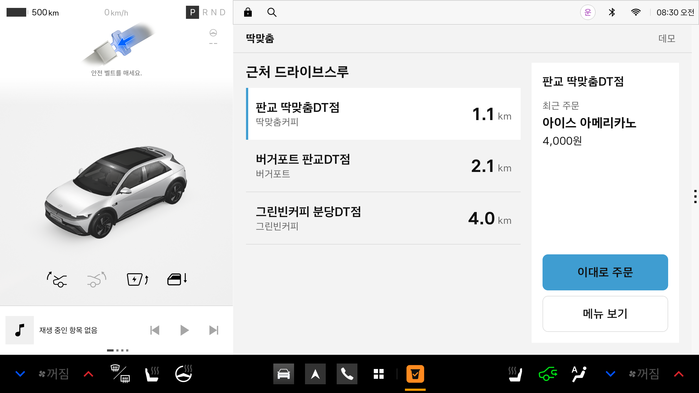 | 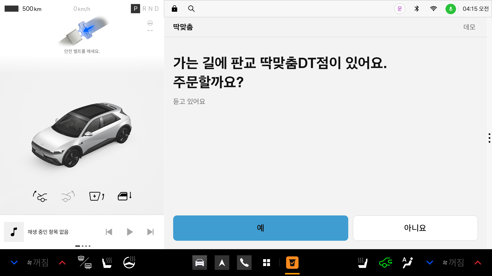 |
| 내비의 현재 위치 기준으로 가까운 매장부터 보여 줍니다. 목적지가 있으면 덜 돌아가는 매장이 위로 오고 "가는 길에 있음", "약 3.0km 돌아감"처럼 표시됩니다. 주문한 적이 있으면 "이대로 주문" 한 번으로 결제까지 갑니다. | 내비에 목적지가 정해지면 가는 길의 매장을 골라 한 문장으로 묻습니다. 말로 답하거나 큰 버튼 하나만 누르면 됩니다. |

| 3. 메뉴 | 4. 결제 (차량 간편결제 또는 QR) |
|---|---|
| 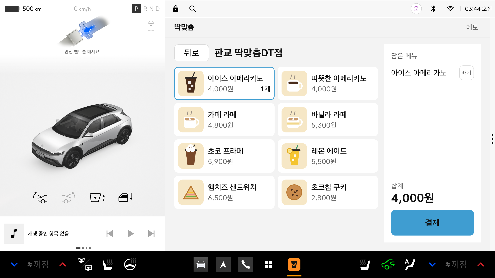 | 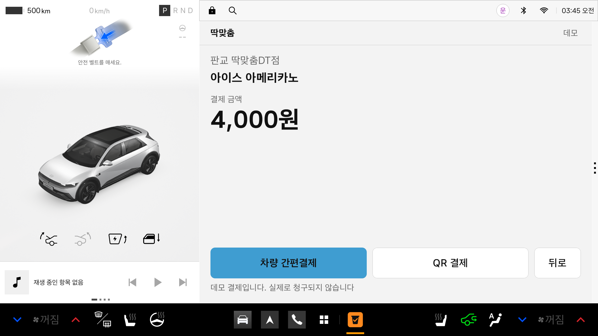 |
| 한 화면에 다 보이는 큰 칸, 누르면 담깁니다. 스크롤과 옵션 선택이 없습니다. 메뉴 그림은 앱이 직접 그립니다. | 차량 간편결제 한 번으로 끝납니다. 동승자가 낼 때는 QR을 폰으로 찍습니다. 둘 다 모의 결제입니다. |

| 5. QR 결제 | 6. 결제 뒤에는 내비 화면, 주문은 작은 카드로 |
|---|---|
| 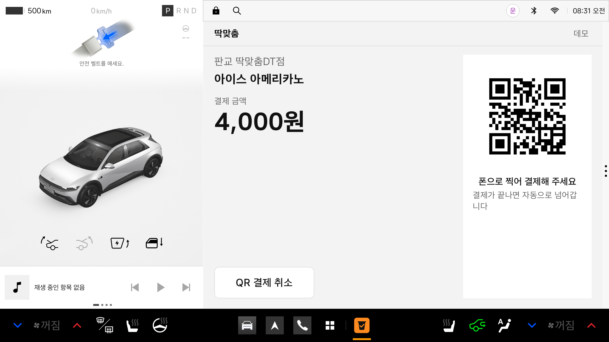 | 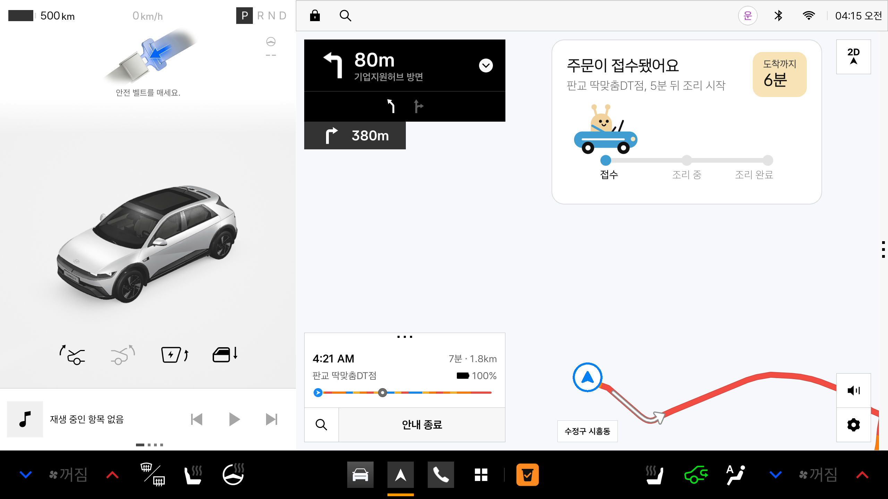 |
| 폰에서 결제가 끝나면 차 화면이 자동으로 넘어갑니다. | 결제가 끝나면 매장이 순정 내비 경로에 들어가고 내비가 앞으로 나옵니다. 주문 상태와 도착까지 남은 시간은 내비 위의 작은 카드로만 보여 줍니다. 접수 단계의 "5분 뒤 조리 시작"은 매장이 도착 시간에 맞춰 만들기 시작한다는 뜻입니다. 카드를 누르면 앱으로 돌아옵니다. |

| 7. 길이 막히면 조리 시작도 같이 밀린다 | 8. 도착이 가까워지면 조리 중 |
|---|---|
| 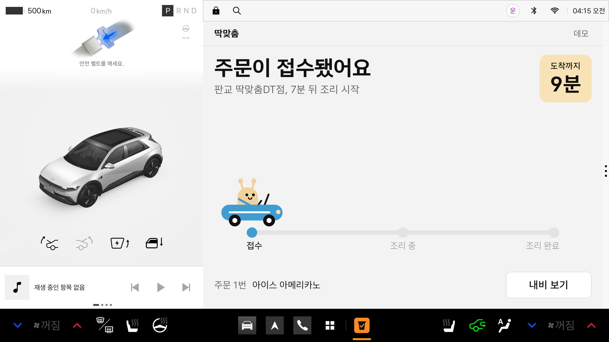 | 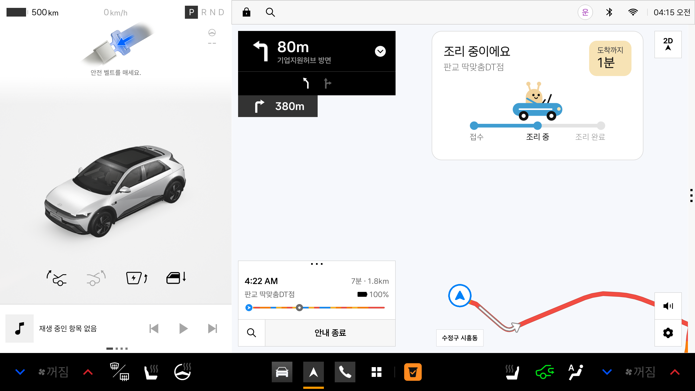 |
| 정체로 도착이 6분에서 9분으로 늦어지자 조리 시작도 "5분 뒤"에서 "7분 뒤"로 밀렸습니다. 카드를 누르면 나오는 앱의 주문 상태 화면입니다. | 도착 1분 20초 전(조리 60초 + 여유 20초)에 매장이 만들기 시작하고 카드가 "조리 중이에요"로 바뀝니다. |

| 9. 도착 직전에 조리 완료 | 10. 도착하면 주문 번호 |
|---|---|
| 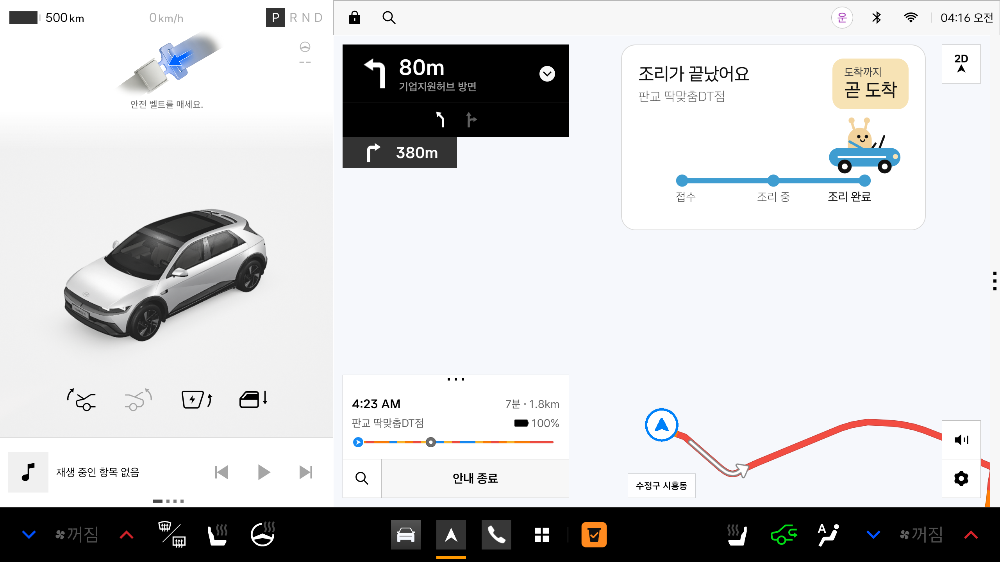 | 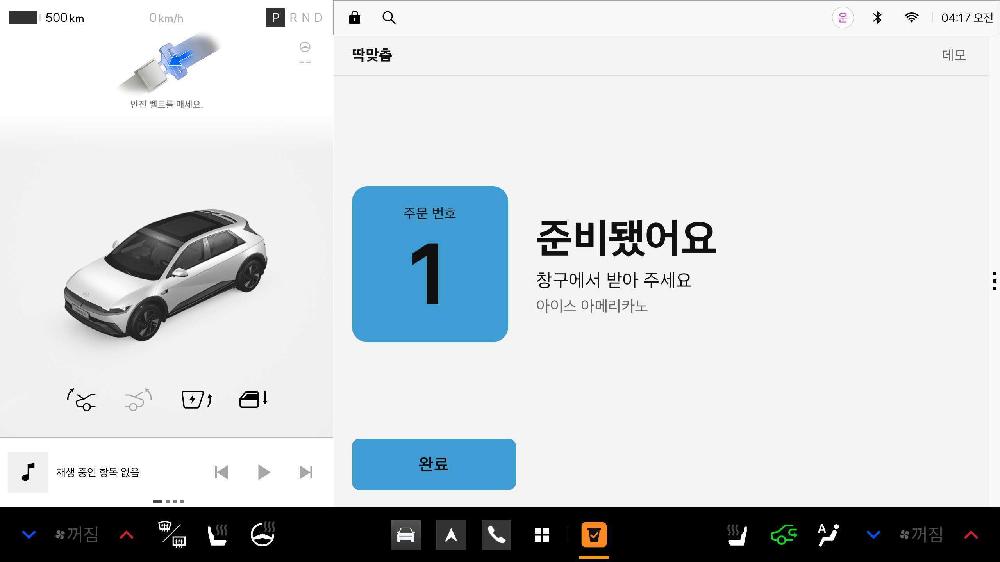 |
| 도착 약 20초 전에 다 만들어지고 카드가 "조리가 끝났어요, 곧 도착"으로 바뀝니다. | 창구에서 번호만 말하면 됩니다. "완료"를 누르면 앱이 내비에 넣은 매장 경로만 정리됩니다. |

예상보다 일찍 도착해 아직 만드는 중이면 "거의 다 됐어요"가 뜨고, 매장은 보류 없이 바로 만듭니다. 다 되면 10번 화면으로 바뀝니다.

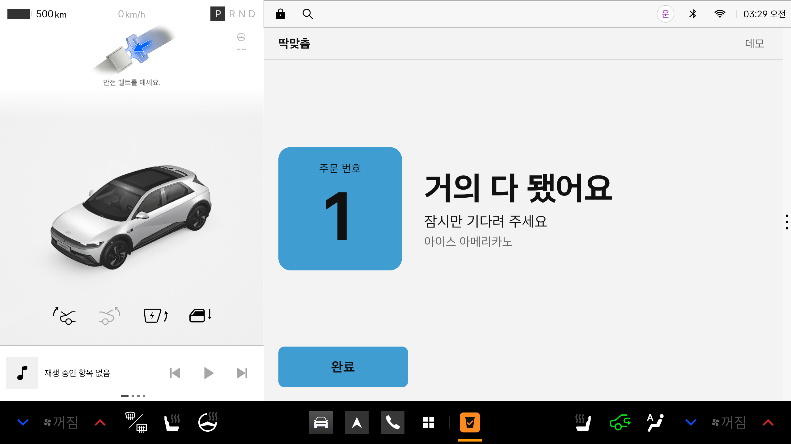

## 어떻게 동작하나

1. 차량 앱이 순정 내비에서 매장까지 **남은 시간과 거리**를 받아 매장 서버로 계속 보냅니다.
2. 매장 서버가 그 매장의 주문을 **도착 예정순**으로 세우고, 각 주문의 조리 시작 시각을 "도착 시각 − 조리 시간 − 20초"로 거꾸로 계산합니다. 너무 일찍 만들어 식거나 얼음이 녹는 일을 막습니다.
3. 길이 막혀 도착이 늦어지면 조리 시작도 같이 뒤로 밀립니다. 다른 차가 먼저 도착하게 되면 순서가 바뀝니다.
4. 운전자는 주문한 뒤 내비 화면만 보면 됩니다. 접수, 조리 중, 조리 완료가 카드에 차례로 뜹니다.

## 빠른 실행 (심사용)

준비물: Pleos Connect 에뮬레이터 v2.1.0, Node.js (매장 서버용, 외부 패키지 없음).

APK 위치: [`apk/빅히어로_딱맞춤_release.apk`](apk/빅히어로_딱맞춤_release.apk) (release 빌드)

```
adb install -r apk\빅히어로_딱맞춤_release.apk
adb shell pm grant --user 10 com.ddakmatchum.car android.permission.RECORD_AUDIO
adb shell pm grant --user 10 com.ddakmatchum.car android.car.permission.CAR_SPEED
adb shell pm grant --user 10 com.ddakmatchum.car android.permission.POST_NOTIFICATIONS
adb shell appops set --user 10 com.ddakmatchum.car SYSTEM_ALERT_WINDOW allow

cd server
node server.js                      # 매장 화면: http://localhost:8787/store

adb shell am start --user 10 -n com.ddakmatchum.car/.MainActivity
```

다섯째 줄(`appops`)은 내비 위에 주문 카드를 띄우는 "다른 앱 위에 표시" 권한입니다. 이 줄을 빼면 카드는 뜨지 않고 알림만 남습니다. 나머지 흐름은 그대로 동작합니다.

시연 순서 (에뮬레이터는 차가 움직이지 않으므로 앱 오른쪽 위 "데모" 패널로 주행을 흉내 냅니다):

1. 앱을 열면 근처 드라이브스루 3곳이 가까운 순으로 나옵니다. 매장을 누르고 "메뉴 보기"로 들어가도 됩니다.
2. "데모" → "목적지 정함 (판교역)": 목적지를 정한 상황이 되어 "가는 길에 판교 딱맞춤DT점이 있어요. 주문할까요?"가 뜹니다.
3. "예" → 메뉴를 눌러 담기 → "결제" → "차량 간편결제".
4. 순정 내비가 앞으로 나오고 그 위에 주문 카드가 뜹니다.
5. 카드를 눌러 앱으로 돌아온 뒤 "데모" → "정체 +3분": 도착이 늦어진 만큼 매장의 조리 시작이 뒤로 밀립니다.
6. "데모" → "매장 앞" → "도착": 주문 번호 화면이 나옵니다. "완료"를 누르면 앱이 내비에 넣은 매장 경로만 정리되어 바로 다시 시연할 수 있습니다.

매장 쪽 계산을 눈으로 확인하려면 PC 브라우저에서 http://localhost:8787/store 를 엽니다. 운전자에게 보이는 화면이 아니라 개발용 확인 화면입니다. 앱에서 넣은 주문이 도착 예정 시각, 조리 시작 시각과 함께 보이고, "정체 시나리오"를 누르면 가상 차량 5대가 도착순으로 다시 줄 서는 것을 볼 수 있습니다. 기본 매장(판교 딱맞춤DT점)의 주문만 보이며, 다른 매장은 주소 끝에 `?store=dt-002`처럼 붙입니다.

그 밖에:

- "데모" → "출발 (6분)"은 목적지가 드라이브스루 매장인 상황입니다. 묻지 않고 그 매장 메뉴가 바로 열립니다.
- QR 결제는 폰이 PC와 같은 와이파이에 있어야 하고, 데모 패널의 "QR 주소"에 PC의 IP를 넣어야 합니다. 폰 없이 넘기려면 PC에서 `curl http://localhost:8787/api/pay`로 코드를 확인하고 `curl -X POST http://localhost:8787/api/pay/코드/done`을 보냅니다.
- 홈 화면 오른쪽의 "최근 주문"은 주문 기록이 있을 때만 나옵니다. "데모" → "기록 초기화"가 시연용 기록 3건을 넣습니다.
- 데모 패널의 "화면 시안" 줄은 개발 중에 비교하던 예전 화면입니다. "기본"이 제출 화면입니다.
- 에뮬레이터에서 PC의 서버 주소는 `http://10.0.2.2:8787`이고 앱의 기본값입니다.

## 구성

| 폴더 | 내용 | 실행 |
|---|---|---|
| `vehicle-app/` | 차량 앱 (Kotlin, Jetpack Compose, Pleos SDK) | `3-build-install.bat` 또는 Gradle |
| `server/` | 매장 서버, 도착순 큐 알고리즘, 개발용 확인 화면, QR 결제 화면 | `node server.js` (설치할 것 없음) |
| `apk/` | 제출용 release APK | `adb install -r` |
| `docs/` | 실행 화면 | |
| `scripts/` | Windows 개발 환경 설치 스크립트 | `1-setup.bat` |

## 무엇이 다른가 (GM Marketplace는 왜 실패했나)

| GM Marketplace (2017~2022 종료) | 딱맞춤 |
|---|---|
| 폰으로 되는 주문을 차 화면에 옮김 | 차만 아는 정보(목적지, 경로, 남은 시간)로 매장의 조리 시작 시점과 순서를 정함 |
| 운전자가 앱을 찾아 열어야 함 → 61%가 한 번도 안 씀 | 목적지를 정하면 가는 길의 매장을 먼저 물음 |
| 운전 중 조작 위험 비판 | 한눈에 읽히는 짧은 화면, 한 손으로 누르는 큰 버튼, 결제는 차량 간편결제 한 번. 주문 뒤에는 내비 화면 그대로 두고 작은 카드만 띄움 |
| 외부 업체가 사업 철수하며 종료 | Pleos 순정 내비와 연동, 매장은 태블릿 한 대면 됨, 결제는 차량 내 간편결제 연동을 가정 |

배달 앱의 포장 주문과도 다릅니다. 포장 주문은 손님이 언제 올지 매장이 모르지만, 딱맞춤은 내비의 남은 시간을 매장에 줍니다. 그래서 드라이브스루만 다룹니다.

## 사용한 Pleos SDK

| SDK | 버전 | 쓰는 곳 | 에뮬레이터 확인 |
|---|---|---|---|
| NaviHelper | 3.0.5 | 현재 위치(근처 매장 정렬), 목적지 감지, 매장을 목적지나 경유지로 추가, 매장까지 남은 시간과 거리, 내비 화면 띄우기 | 경로 요청 후 순정 내비가 안내 시작. 목적지가 이미 있을 때 매장이 경유지로 들어감. `onDrivingInfo`로 남은 시간(초)과 거리(m) 수신. 내비 화면 전환 |
| TextToSpeech | 3.3.1 | 묻기와 진행 상황 음성 안내 (온디바이스) | 문장 재생 시작까지 확인 |
| SpeechToText | 3.3.1 | "응/아니" 음성 답변 (온디바이스) | 듣기 상태 진입까지 확인. 실제 발화 인식은 미확인 |
| Vehicle | 2.3.2 | 기어(P/D) 수신 | 값 수신. 지금 화면에서는 값만 받고 화면을 바꾸는 데 쓰지 않음 |
| AAOS Car API | - | 속도(매장 앞 차선 진입 판단) | 동작 |

Pleos SDK 호출은 모두 실패해도 앱이 죽지 않게 감쌌고, 순정 내비가 4초 안에 연결되지 않으면 데모 주행 모드로 바뀝니다. 주문부터 수령까지는 포그라운드 서비스로 추적을 유지해, 내비 화면이 앞에 있어도 남은 시간 전송이 끊기지 않습니다.

## 핵심 알고리즘 (`server/queue.js`)

1. **도착 예정순 정렬**: 각 주문의 도착 예정 = 마지막 남은 시간 수신 시각 + 남은 시간
2. **흔들림 방지**: 두 차의 도착 차이가 45초 미만이면 순서 유지 (6분과 7분 사이를 오가는 정도는 무시)
3. **차선 진입 = 순서 확정**: 매장 150m 안 + 시속 15km 이하면 실제 줄 순서로 고정
4. **조리 시작 시각 역산**: 도착 − 조리 시간 − 20초. 너무 일찍 만들어 얼음이 녹는 것도 막음
5. **만드는 사람 수 반영**: 주문이 몰려 도착까지 못 맞추면 "지연 예상"으로 표시하고, 앱에는 "조금 늦어질 수 있어요"가 나옴
6. **보류**: 60초 이상 신호 끊김이나 경로 이탈이면 조리를 보류하고 뒤로
7. **현장 주문 혼합**: 현장 주문은 이미 줄에 있는 차로 취급 → 이 앱을 쓰는 차가 1대뿐이어도 동작
8. **매장마다 따로**: 순서와 만드는 사람 수는 매장 단위로 계산. 다른 매장의 주문이 끼어들지 않음
9. **도착한 차는 바로**: 창구에 온 차의 주문은 보류하지 않고 곧바로 만듦

테스트: `cd server && node queue.test.js` (9개)

## 에뮬레이터에서 확인한 것과 못 한 것

| 항목 | 상태 |
|---|---|
| 전체 흐름 (근처 매장 → 묻기 → 메뉴 → 결제 → 내비 전환 → 주문 카드 → 조리 중 → 조리 완료 → 도착 → 완료) | 확인 (debug 빌드는 PC 명령으로, release 빌드는 화면 탭만으로) |
| 근처 매장 3곳이 거리순으로 표시, 매장별 메뉴, 메뉴 그림 | 확인 |
| QR 결제 화면과 결제 완료 뒤 자동 진행 | 확인 (결제 완료는 PC에서 대신 보냄. 폰으로 실제로 찍어 보지는 못함) |
| 목적지가 이미 있을 때 매장이 경유지로 들어가고, "완료" 때 경유지만 빠짐 | 확인 (순정 내비에 판교역을 목적지로 넣은 상태, 내비 로그) |
| 목적지가 없을 때 근처 매장(다른 브랜드 포함)을 골라 주문하면 그 매장이 목적지로 들어가고, "완료" 때 그 안내만 끝남 | 확인 |
| 목적지가 드라이브스루 매장이면 묻지 않고 그 매장 메뉴가 바로 열림 | 확인 (데모 주행의 목적지로) |
| 내비 위 주문 카드가 접수, 조리 중, 조리 완료, 도착으로 바뀜 | 확인 (권한을 허용한 상태. 서버가 남은 시간에 맞춰 스스로 바꿈) |
| 접수 단계의 "N분 뒤 조리 시작" 문구, "도착까지" 표시 | 확인 |
| 도착 시간에 맞춘 조리 | 확인 (데모 주행, 조리 60초인 메뉴. 도착 84초 전부터 지켜봤을 때 도착 69초 전에는 조리 중, 도착 9초 전에는 조리 완료였고 도착 화면은 "준비됐어요") |
| 정체 +3분에 조리 시작이 같이 밀림 | 확인 |
| 먼저 도착했을 때 "거의 다 됐어요"에서 "준비됐어요"로 바뀜 | 확인 (주문 직후 도착, 약 1분 뒤 바뀜) |
| 수령 뒤 같은 목적지로 다시 묻지 않음 | 확인 (순정 내비에 목적지가 남아 있는 상태) |
| 내비 화면이 앞에 있는 동안 주문 추적 유지, 카드를 누르면 앱으로 복귀 | 확인 |
| 데모 패널의 "목적지 정함" 버튼 (여러 번 다시 눌러도 매번 묻기) | 확인 |
| 매장별로 따로 줄 세우기 | 확인 (서버 테스트와 실제 요청) |
| 이 release APK의 설치와 실행, PC 명령 무시 | 확인 |
| 운전자가 내비 화면에서 직접 목적지를 정했을 때의 감지 | 미확인 (앱이 내비에 요청한 목적지로만 확인) |
| 음성으로 "응"이라고 답했을 때의 인식 | 미확인 (듣기 상태 진입까지만 확인) |
| 실제 주행에 따라 남은 시간이 줄어드는 것 | 미확인 (에뮬레이터는 차가 움직이지 않아 데모 주행 모드로 대신함) |
| 실차 | 미확인 |

## 실행 방법 (Windows, 소스에서 빌드)

자세한 건 [WINDOWS_SETUP.md](WINDOWS_SETUP.md). 폴더를 한글이 없는 경로(예: `C:\ddakmatchum`)에 두고 번호 순서대로 더블클릭합니다.

| 순서 | 파일 | 하는 일 |
|---|---|---|
| 1 | `1-setup.bat` | Node.js, JDK 21, Android Studio, Android SDK, Pleos Connect 에뮬레이터 이미지와 기기를 `C:\Android`에 설치 (처음 한 번, 관리자 권한 불필요, 약 33GB) |
| 2 | `2-start-emulator.bat` | Pleos Connect 에뮬레이터 실행. 화면이 뜬 뒤 3분쯤 기다린 다음 진행 |
| 3 | `3-build-install.bat` | 차량 앱 빌드, 에뮬레이터에 설치, 권한 허용, 실행 |
| 4 | `4-start-server.bat` | 매장 서버 실행, 매장 화면(http://localhost:8787/store) 열기 |

명령어로 직접 할 때:

```
cd vehicle-app
.\gradlew.bat assembleRelease       # app\build\outputs\apk\release\app-release.apk

cd ..\server
node server.js                      # 매장 화면: http://localhost:8787/store
```

사양이 낮은 PC에서는 에뮬레이터를 켜기 전에 빌드를 먼저 끝내는 편이 안정적입니다.

debug 빌드에서는 화면을 누르지 않고 PC에서 단계를 넘길 수 있습니다 (release에서는 무시됩니다).

```
adb shell am start --user 10 -f 0x20000000 -n com.ddakmatchum.car/.MainActivity --es demo dest
# demo: dest(목적지를 정한 상황), yes, no, start(목적지가 매장인 상황), add(첫 메뉴 담기), gopay, paycar, payqr,
#       back, navi, jam(정체 +3분), near(매장 앞), eta(남은 시간 맞추기, --ei sec 84), arrive, finish, reset(시연용 주문 기록)
# 예: dest → yes → add → gopay → paycar → near → arrive → finish
# 도착에 맞춰 완성되는 장면: ... → paycar → eta --ei sec 84 → 84초 기다림 (조리 중, 조리 완료, 도착이 차례로 나옴)
```

## 테스트 환경

| 항목 | 값 |
|---|---|
| 차량 플랫폼 | Pleos Connect 에뮬레이터 v2.1.0 (Android 14, API 34, x86_64) |
| 화면 규격 | 2560x1440, 160dpi (기기 정의 `Pleos_Connect_v2_0`). 앱 창은 오른쪽 영역에 뜸 |
| 에뮬레이터 설정 | Android Emulator 37.2.13, 그래픽 `-gpu host`, 가상 CPU 4개, RAM 4GB, 가속 AEHD 2.2 |
| 빌드 도구 | Android Gradle Plugin 8.8.2, Kotlin 2.0.21, Gradle 8.10.2, JDK 21 |
| SDK 설정 | compileSdk 35, targetSdk 34, minSdk 28 |
| 매장 서버 | Node.js (외부 패키지 없음) |
| 확인한 PC | Windows 11, Intel Core i5-14400F, RAM 32GB, GeForce GTX 1660 (2026-11-15) |

## 알려진 한계

- 에뮬레이터에서만 확인했습니다. 실차에서는 돌려 보지 못했습니다.
- 내비 위 주문 카드는 "다른 앱 위에 표시" 권한이 필요합니다. 에뮬레이터에서는 위의 `appops` 명령으로 허용했습니다. 실차에서 이 권한이 허용되는지는 확인하지 못했습니다. 권한이 없으면 주문 완료 화면을 잠깐 보여 준 뒤 내비로 넘어가고 알림만 남습니다.
- 목적지를 정했을 때 먼저 묻는 것은 앱이 켜져 있을 때만 됩니다. 앱이 꺼진 상태에서 스스로 뜨는 것은 만들지 않았습니다.
- 에뮬레이터 순정 내비의 현재 위치는 한곳에 고정이고 차가 움직이지 않습니다. 그래서 남은 시간이 줄어드는 과정은 데모 주행 모드로 보여 줍니다. 데모 매장 좌표는 그 위치 근처의 가상 좌표입니다.
- 근처 매장의 거리와 "가는 길" 판단은 직선 거리로 추정합니다 (내비 SDK에 장소 검색과 경로 거리 조회가 없습니다). 그래서 목록의 1.1km와 내비의 1.8km처럼 숫자가 다를 수 있습니다. 직선 거리로 1km 넘게 돌아가는 매장은 먼저 묻지 않습니다.
- 조리를 시작한 뒤에 길이 막히면 그 주문은 되돌릴 수 없습니다. 조리 시작을 도착 직전(조리 시간 + 20초 전)까지 미루기 때문에 그런 일이 생길 수 있는 시간은 짧습니다.
- 주문 취소와 환불 흐름은 없습니다.
- 동승자 감지와 말로 메뉴를 고르는 기능은 없습니다. 결제 수단 두 가지를 항상 같이 보여 줍니다.
- 결제는 모의 결제입니다. 차량 내 간편결제와의 실제 연동 코드는 없습니다.
- release APK는 별도 키가 아니라 debug 키로 서명했습니다.

## 데모 데이터 안내

매장 3곳과 브랜드 이름(딱맞춤커피, 버거포트, 그린빈커피), 메뉴는 모두 가상 데이터이고 좌표도 실제 매장이 아닙니다. 결제는 **차량 내 간편결제 연동을 가정한 모의 결제**이며 실제로 청구되지 않습니다. 시연용 주문 기록은 데모 패널의 "기록 초기화"를 눌렀을 때만 들어갑니다.
